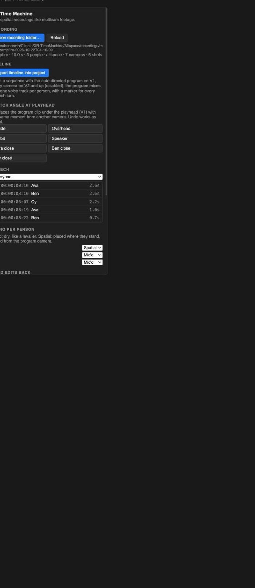

# XR Time Machine for Premiere

A Premiere Pro panel (UXP, Premiere 25.6 or later; built against 26.3) for editing spatial recordings like multicam footage.

## What it does

- **Open a recording folder.** It reads `session.json` and the studio export (`studio/project.json`), then lists the cameras, cuts, speech turns and people.
- **Import the timeline.** This brings in `studio/sequence.xml` and makes the sequence active:
  - V1 holds the auto-directed program, built from the iso camera clips with real cuts and dissolves.
  - V2 and up hold every camera, full length and disabled.
  - The audio tracks are the program mix (mic'd), the program mix (spatial, muted), and one dry voice per person.
  - Every speech turn is a marker.
- **Switch angle at the playhead.** It replaces the V1 clip under the playhead with the same moment from another camera, like a multicam switch. It runs as three undoable steps: mark the source, overwrite, clear the marks.
- **Jump to speech.** Click a turn to move the playhead there. You can filter by person.
- **Set audio per person.** Each person can be "mic'd" (dry, like a lavalier) or "spatial" (placed where they stand, heard from the program camera).
- **Send edits back.** It writes your V1 cut and audio choices into `studio/project.json`, keeping a backup as `project.backup.json`. Run `npm run studio` again to re-render the program movie and mixes to match.

## Install

**First, either way:** in Premiere, go to **Settings → Plugins** and tick **Enable developer mode**, then restart Premiere. Adobe requires this for plugins that aren't from the Marketplace.

**A. Double-click the package.** Run `npm run package` here, then double-click `dist/org.xrtimemachine.premiere_premierepro.ccx`. Creative Cloud installs it after a warning that it isn't from the Marketplace. Open it from **Window → UXP Plugins → XR Time Machine**.

**B. UXP Developer Tool**, for working on the panel. Install **UXP Developer Tools** from the Creative Cloud app, click **Add Plugin**, pick this folder's `manifest.json`, then click **Load**. **Reload** picks up edits, and **Debug** opens DevTools for the panel.

## Use

1. Make a studio export of a recording: `cd Altspace && npm run studio -- recordings/demo-campfire`.
2. In Premiere, open or create a project, then open the panel.
3. Click **Open recording folder…** and choose the recording folder (the one containing `session.json`).
4. Click **Import timeline into project**.
5. Edit as usual. Use the camera buttons to switch angles at the playhead, and the speech list to jump around.
6. Click **Use this sequence's cut** and/or **Save audio modes**, then re-run the command the panel shows.

## Files

| File | |
|---|---|
| `manifest.json` | UXP manifest v5: one panel, `localFileSystem: request` (folder picker), clipboard for "Copy command" |
| `index.html`, `main.js` | the panel UI |
| `lib.js` | all the logic: parsing, cut mapping, and the Premiere operations, which take the `premierepro` module as a parameter |
| `test/lib.test.js` | `npm test`: 10 tests of `lib.js` against `test/fake-premiere.js`, a fake of the Premiere API that applies actions the way Premiere does |
| `test/preview.html` | the real panel in a browser with fake Premiere and UXP modules: `node test/preview-server.mjs`, then open http://localhost:5180 |
| `scripts/package.js` | builds the `.ccx` |

## Status: what's verified and what isn't

The panel has **not run inside Premiere yet**; there was no way to drive Premiere here. What is checked:

- **The API calls** come from Adobe's 26.3 reference docs and the official `uxp-premiere-pro-samples` code: `Project.importFiles`, `getSequences`, `setActiveSequence`, `Sequence.getVideoTrack`, `getPlayerPosition`/`setPlayerPosition`, `VideoTrack.getTrackItems`, `ClipProjectItem.cast`, `getMediaFilePath`, `createSetInOutPointsAction`, `createClearInOutPointsAction`, `SequenceEditor.getEditor`, `createOverwriteItemAction`. Every edit runs inside `lockedAccess` → `executeTransaction`, as 26.3 requires.
- **The logic** passes its tests against the fake. That includes switching angle (exact span, same recording moment, neighbours untouched, marks cleared) and reading the cut back by media path.
- **The UI** runs in the browser preview with the same `main.js` and `lib.js`.

Most likely to need a tweak in real Premiere:
- How `importFiles` names the sequence it creates from the XML. If it doesn't become active, open it from the Project panel; the log says so.
- Whether `createOverwriteItemAction` honours the source clip's in/out marks. This is how Premiere's own Overwrite works, but it's untested through the API.
- UXP's support for `<select>` and `innerHTML`.
